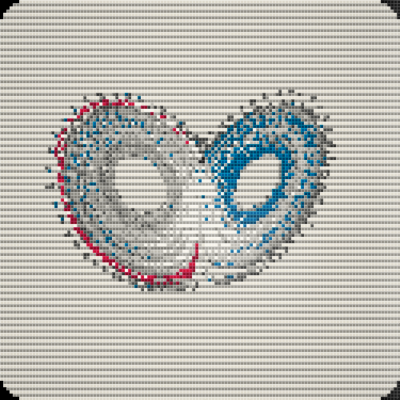
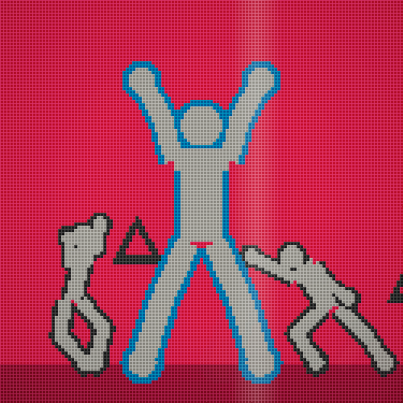
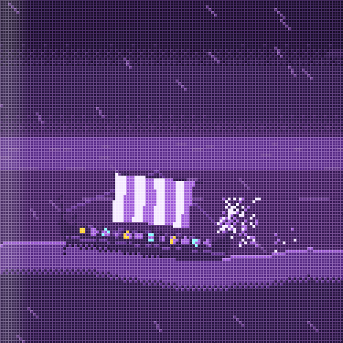
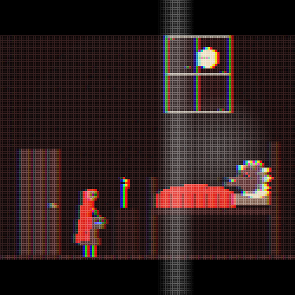
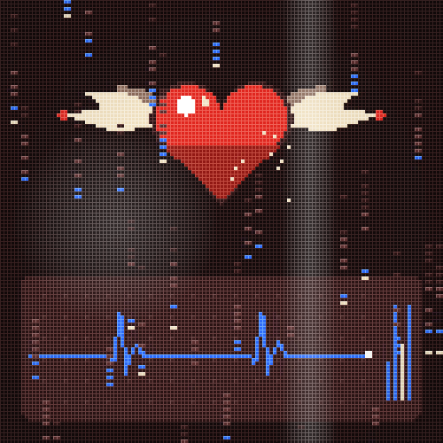

<p align="center">
  
</p>

<p align="center">
  <a href="https://comecloseandlisten.github.io/ep-visual/"></a>
</p>

<h3 align="center">it listens. it reads the mood. it paints.</h3>

<p align="center">
  <code>mood → pixels</code> &nbsp;·&nbsp; <code>1000 × 1000</code> &nbsp;·&nbsp; <code>41 styles</code> &nbsp;·&nbsp; <code>414 scenes</code> &nbsp;·&nbsp; <code>no install</code>
</p>

<br>

## `01` play


**drop a sound on a pad** &nbsp;and hit it: `1 2 3 · q w e · a s d · z x c`<br>
**line in** &nbsp;plug in a sampler, a mixer, a mic<br>
**spotify** &nbsp;let it hear whatever the computer plays

the canvas follows the tempo, the key, the bass and the hats. a breakdown dries it to paper,
a drop throws a whole new picture.

<br>

## `02` worlds

<table>
  <tr>
    <td width="20%" align="center"><br><sub><code>kandinsky</code></sub></td>
    <td width="20%" align="center"><br><sub><code>chaos</code></sub></td>
    <td width="20%" align="center"><br><sub><code>openings</code></sub></td>
    <td width="20%" align="center"><br><sub><code>casino</code></sub></td>
    <td width="20%" align="center"><br><sub><code>coffee</code></sub></td>
  </tr>
  <tr>
    <td width="20%" align="center"><br><sub><code>anime</code></sub></td>
    <td width="20%" align="center"><br><sub><code>north</code></sub></td>
    <td width="20%" align="center"><br><sub><code>riley</code></sub></td>
    <td width="20%" align="center"><br><sub><code>doomer</code></sub></td>
    <td width="20%" align="center"><br><sub><code>epic</code></sub></td>
  </tr>
  <tr>
    <td width="20%" align="center"><br><sub><code>space</code></sub></td>
    <td width="20%" align="center"><br><sub><code>street</code></sub></td>
    <td width="20%" align="center"><br><sub><code>te</code></sub></td>
    <td width="20%" align="center"><br><sub><code>pop</code></sub></td>
    <td width="20%" align="center"><br><sub><code>fairy</code></sub></td>
  </tr>
  <tr>
    <td width="20%" align="center"><br><sub><code>bangkok</code></sub></td>
    <td width="20%" align="center"><br><sub><code>ps1</code></sub></td>
    <td width="20%" align="center"><br><sub><code>y2k</code></sub></td>
    <td width="20%" align="center"><br><sub><code>indie</code></sub></td>
    <td width="20%" align="center"><br><sub><code>surreal</code></sub></td>
  </tr>
</table>

<p align="center"><sub>real frames, straight off the canvas</sub></p>

art movements · poster stories · retro screens · 32-bit 3d · anime · cinema · title sequences ·
strange attractors · norse tales · fairy tales · crime · shooters · bangkok · surreal · and more.
all of it original silhouettes: no real people, no logos, no borrowed characters.

<br>

## `03` run it yourself

```bash
python -m http.server 8000
```

open <http://localhost:8000> &nbsp;·&nbsp; `ctrl+s` saves a png &nbsp;·&nbsp; **rec** saves a clip

<br>

<p align="center">
  <sub>mit &nbsp;·&nbsp; not affiliated with teenage engineering &nbsp;·&nbsp; for agents: <a href="AGENTS.md">AGENTS.md</a></sub>
</p>
