<p align="center">
  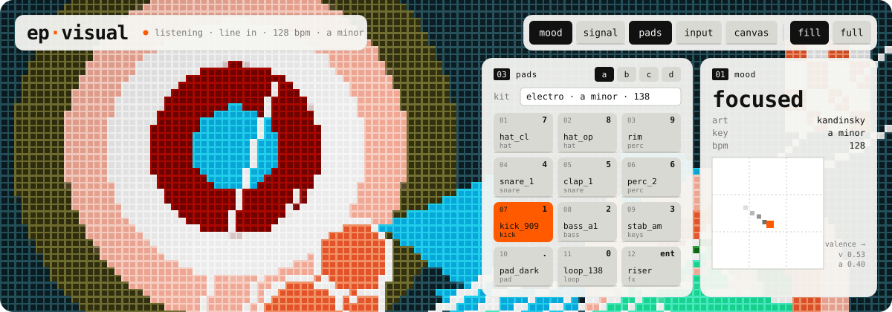
</p>

<p align="center">
  <code>mood → pixels</code> &nbsp;·&nbsp; <code>1000 × 1000</code> &nbsp;·&nbsp; <code>no build</code> &nbsp;·&nbsp; <code>no deps</code> &nbsp;·&nbsp; <code>mit</code>
</p>

a page that listens to music, reads its mood and paints it as generative pixel art on a white
1000×1000 canvas. plain es modules, nothing to install.

born as the visualizer of a set of tools for teenage engineering ep samplers, so it is laid out like one:
a 3×4 pad grid in four groups, keys like the ep's keypad. not affiliated with teenage engineering.

## `01` run

the page uses es modules, so serve the folder over http instead of opening the file:

```bash
python -m http.server 8000
```

then open <http://localhost:8000>. any static server works.

## `02` listen

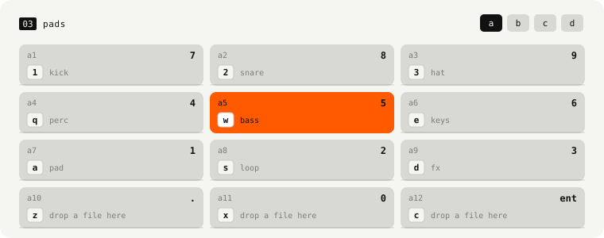

- **pads** · drop an audio file on a pad, or anywhere on the page. play with the mouse, the keys
  `1 2 3 / q w e / a s d / z x c` or the numeric keypad. files named like their pad (`a10_kick`) go there.
- **line in** · an audio input: a sampler through a sound card, a mixer, a microphone. a stereo pair of a
  multichannel interface can be picked.
- **spotify** · whatever the computer plays: a stereo mix / loopback input, or the system audio shared from
  the browser's screen-share dialog.

from that it reads loudness, spectrum bands, brightness, attacks and their rate, bpm and key, and places
the moment on a valence × arousal map. the mood picks the art.

## `03` paint

<table>
  <tr>
    <td>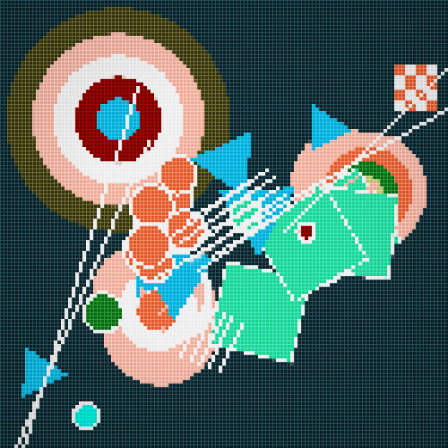<br><sub><code>kandinsky</code></sub></td>
    <td>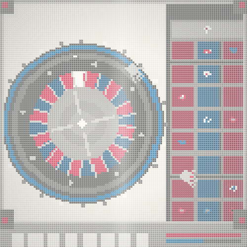<br><sub><code>casino</code></sub></td>
    <td>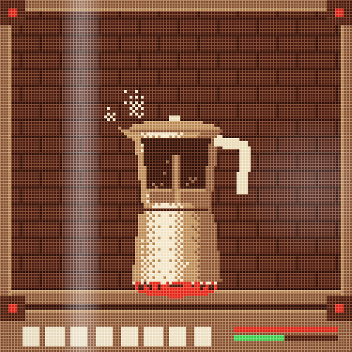<br><sub><code>coffee</code></sub></td>
    <td>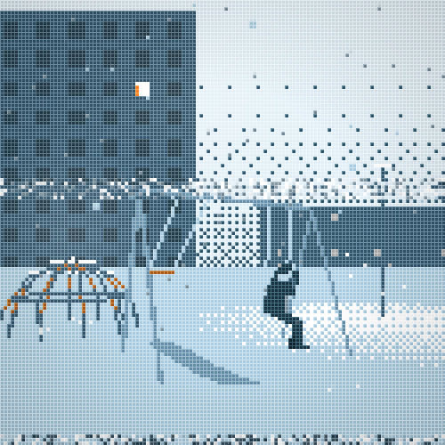<br><sub><code>doomer</code></sub></td>
  </tr>
  <tr>
    <td>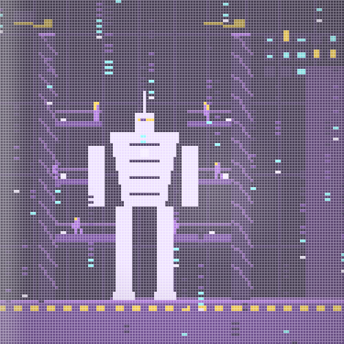<br><sub><code>anime</code></sub></td>
    <td>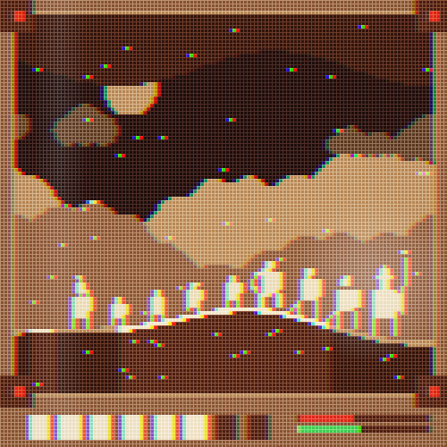<br><sub><code>epic</code></sub></td>
    <td>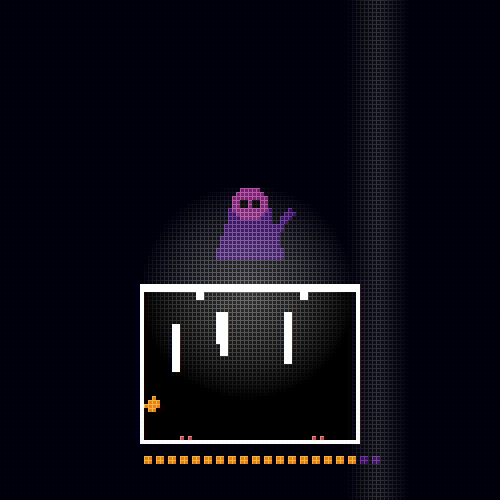<br><sub><code>indie</code></sub></td>
    <td>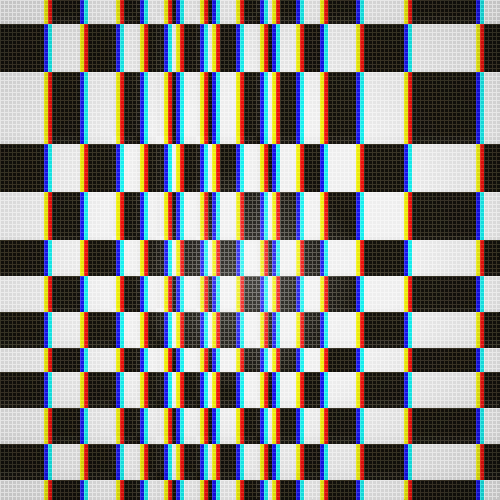<br><sub><code>riley</code></sub></td>
  </tr>
  <tr>
    <td>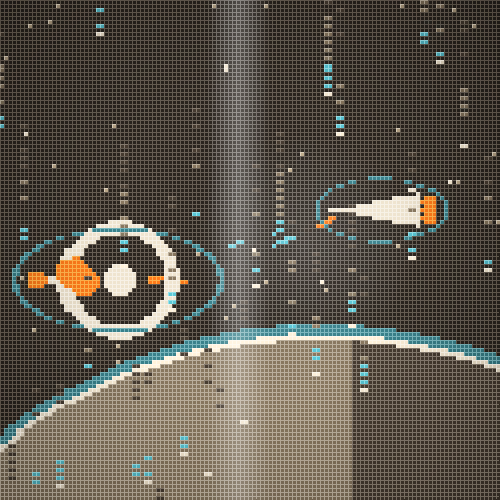<br><sub><code>space</code></sub></td>
    <td>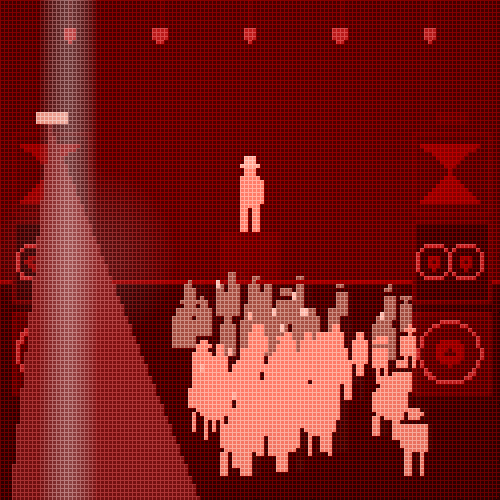<br><sub><code>street</code></sub></td>
    <td>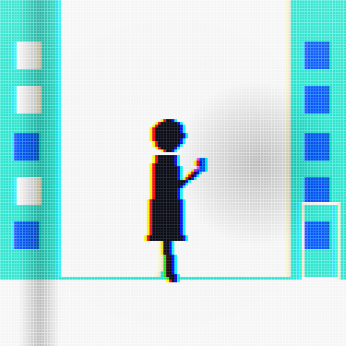<br><sub><code>te</code></sub></td>
    <td>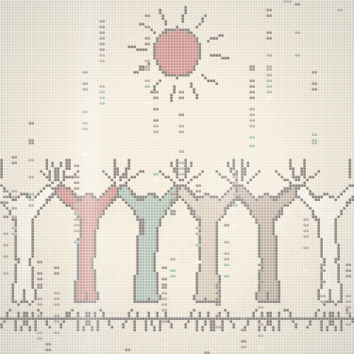<br><sub><code>pop</code></sub></td>
  </tr>
  <tr>
    <td>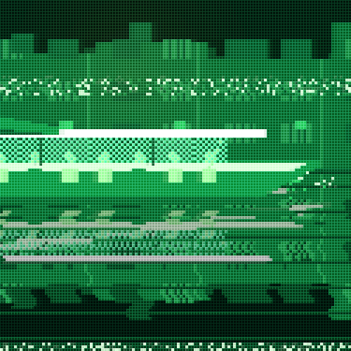<br><sub><code>bangkok</code></sub></td>
    <td>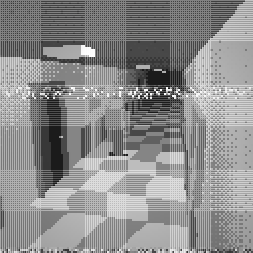<br><sub><code>ps1</code></sub></td>
    <td>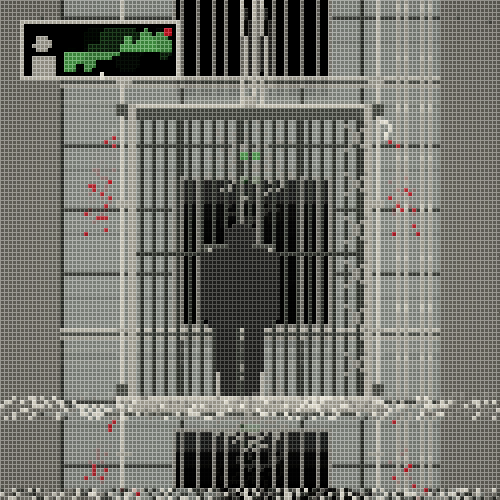<br><sub><code>stealth</code></sub></td>
    <td>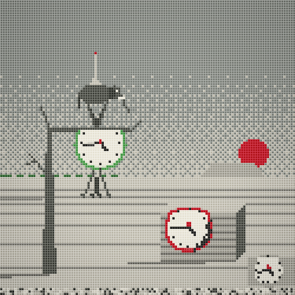<br><sub><code>surreal</code></sub></td>
  </tr>
</table>

<sub>real frames of the page, each world forced from the <b>art</b> menu while a test groove plays.</sub>

worlds come in families (`js/*.js`, registered in `js/styles.js` through `js/mixer.js`): classic art
movements, flat poster stories (`te.js` + `story.js`), retro screens, 32-bit console 3d, anime, cinema, pop
art, fairy tales, crime pictures, shooters, medieval, bangkok, surreal, off-road and more. every family
draws tropes as original silhouettes and sets: no real people, characters, logos or readable text from
actual works.

`ctrl+s` saves the canvas as png · **rec** records it with its sound and downloads the clip as webm.

## `04` groove

on top of the mood the page follows the groove (`js/groove.js`). it tells the groove, peaks, pits,
breakdowns, build-ups and drops apart, finds the phrase length (2–16 bars) and decides how much visual
load the music can take right now: how many hits reach the canvas, which treatments and transitions the
mix may use, how loud the light show is. a drop starts a fresh picture over the whole canvas.

## `05` server

the page also talks to a local server when there is one and quietly does without it otherwise:

| endpoint | what it gives the page |
| --- | --- |
| `GET /api/samples` | a sample library: `{library_dir, samples: [{folder, name, url, mtime}]}`; folders become kits |
| `GET /api/events` | server-sent events: pad notes and beat clock of a jam, the track playing on the computer, recording commands |
| `GET /api/loopback` | the computer's audio output as a stream |
| `WS /api/frames` · `WS /api/td` · `/api/td/frame` | a touchdesigner bridge (`td.html` is the page touchdesigner renders) |
| `/api/record/claim` · `/api/record/upload` | remote-triggered recording |

that server is not part of this repository.

## `06` profiles

`js/profiles.js` ranks every world on load, motion, reaction, pulse and burst, so the page can match a
world to what the music does. regenerate it after adding worlds:

```bash
node tools/profile_scenes.mjs
```

## `07` license

mit · see [LICENSE](LICENSE).
